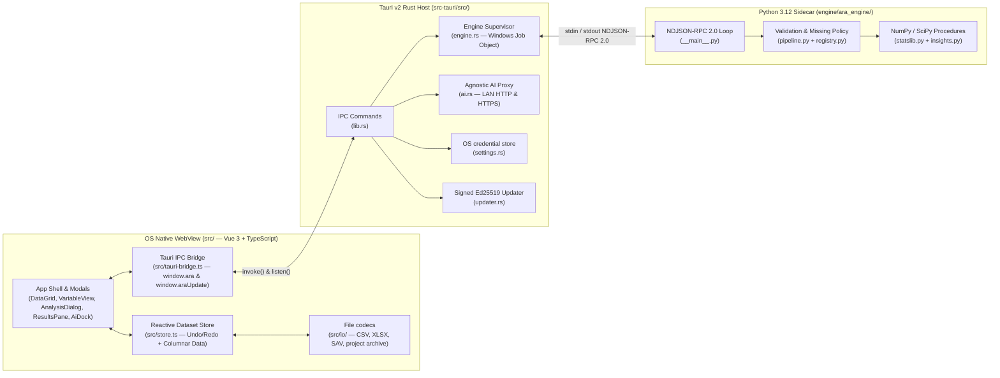

# ARAStat — System Architecture Reference (`architecture.md`)

**Stack**: **Tauri v2 (Rust Host) + Vue 3 / TypeScript (Flat `src/`) + Python 3.12 (`ara_engine` Sidecar)**  
**Core Tenets**: **100% Local-First · Privacy-First · Provider-Agnostic AI · Golden-Tested Statistical Rigor**

---

## 1. High-Level System Topology



---

## 2. Compact Repository Structure

ARAStat enforces a flat, four-folder root directory (`engine/`, `src/`, `src-tauri/`, `tests/`) with zero nested enterprise boilerplate:

```text
arastat/
├── engine/                          # Python 3.12 statistical engine & fixture tools
│   ├── ara_engine/
│   │   ├── __main__.py              # Entry point (`python -m ara_engine`)
│   │   ├── registry.py              # Canonical schema & title registry for all analyses
│   │   ├── pipeline.py              # Input validation, listwise/pairwise policy, element builder
│   │   ├── statslib.py              # Pure NumPy/SciPy statistical implementations
│   │   ├── insights.py              # Diagnostic checks and SVG chart generators
│   │   └── fixtures.py              # Deterministic golden fixture generator (`ara_engine.fixtures`)
├── src/                             # Flat Vite + Vue 3 frontend root
│   ├── index.html                   # Strict CSP entry HTML
│   ├── main.ts                      # App bootstrap (installs the Tauri bridge before mounting Vue)
│   ├── tauri-bridge.ts              # Maps `window.ara` & `window.araUpdate` to `@tauri-apps/api`
│   ├── store.ts                     # Columnar reactive dataset state + transactional undo/redo
│   ├── specs.ts                     # Frontend analysis schemas (mirrors registry.py)
│   ├── runAnalysis.ts               # RPC client wrapper & notification stream router
│   ├── results.ts                   # Reactive Run & ResultElement state tree
│   ├── exports.ts                   # APA 7th HTML & TSV clipboard/file exporters
│   ├── advisor.ts                   # Local statistical test & data readiness advisor
│   ├── quality.ts                   # 10-detector column quality & health scanner
│   ├── expr.ts                      # CSP-safe recursive-descent formula evaluator (no eval)
│   ├── missing.ts                   # Imputation & missingness utilities
│   ├── transforms.ts                # Log, Z-score, binning, and category merge transforms
│   ├── io/                          # File format codecs (.ara.zip, CSV, XLSX, SAV)
│   └── shared/                      # TypeScript IPC contracts (bridge-api.ts, update-api.ts)
├── src-tauri/                       # Rust host crate (`arastat`)
│   ├── tauri.conf.json              # Frameless window, strict CSP, sidecar & updater config
│   ├── capabilities/default.json    # Least-privilege Tauri v2 capability ACL
│   └── src/
│       ├── main.rs                  # Binary entry point
│       ├── lib.rs                   # Tauri builder, command registration, lifecycle hooks
│       ├── engine.rs                # Python sidecar process supervisor & orphan prevention
│       ├── ai.rs                    # Provider-agnostic AI HTTP client
│       ├── settings.rs              # Provider settings and OS credential store
│       ├── urlpolicy.rs             # AI endpoint policy
│       ├── commands.rs              # Native file and AI commands
│       ├── seam.rs                  # Engine RPC framing and multiplexing
│       └── updater.rs               # Ed25519 signed update state machine & GitHub release notes
└── tests/                           # Automated verification suite
    ├── ref.test.js                  # Golden reference parity runner (`rel=1e-9`, `abs=1e-12`)
    ├── *.test.js                    # Unit tests for store, quality, advisor, io, exports
    └── fixtures/                    # Golden CSV inputs, specs, and expected JSON outputs
        ├── tier1/                   # Core parametric & nonparametric golden fixtures
        └── tier2/                   # Advanced & multivariable golden fixtures
```

---

## 3. Subsystem Contracts & Invariants

### 3.1 Frontend Dataset Store (`src/store.ts` & `src/io/types.ts`)
- **Columnar In-Memory Representation**:
  - `state.ds.columns`: `ColumnMeta[]` (`name`, `type: 'numeric' | 'string' | 'date'`, `decimals`, `label`, `valueLabels`, `missing: { values, ranges }`, `width`, `align`, `measure: 'nominal' | 'ordinal' | 'scale' | 'ratio'`).
  - `state.ds.data`: `Record<string, Array<number | string | null>>` where every column array has identical length `rowCount`.
- **Transactional Undo/Redo**:
  - Dataset mutations commit reversible events to the undo stack. AI computed-column proposals are applied as one undoable dataset change, including their formula records.
- **User-Missing Semantics (`isUserMissing`)**:
  - A cell is treated as missing if its value is `null` or matches the column's `missing.values` or `missing.ranges` (`[low, high]`). Importers also translate their configured missing tokens to `null`.
  - Before sending data to `ara_engine`, `src/runAnalysis.ts` converts all user-missing cells to `null` so the Python engine receives clean `null`-normalized arrays.

### 3.2 Native-to-Engine JSON-RPC 2.0 Protocol (`src-tauri/src/engine.rs` ↔ `engine/ara_engine/__main__.py`)
- **Transport**: Newline-delimited UTF-8 JSON (`NDJSON-RPC 2.0`) over child `stdin` and `stdout`.
- **Process supervision**:
  - `engine.rs` starts `python -m ara_engine` using the bundled or development `.venv`, falling back to a PATH interpreter when no venv is present.
  - **Windows**: Attempts to assign the child to a Win32 Job Object configured with `JOB_OBJECT_LIMIT_KILL_ON_JOB_CLOSE`; assignment failure is logged.
  - Child shutdown is also tied to the host lifecycle.
- **Request (`run_analysis`)**:
  ```json
  {
    "jsonrpc": "2.0",
    "id": 1,
    "method": "run_analysis",
    "params": {
      "runId": "run-1",
      "analysisId": "ttest_independent",
      "spec": { "dep": "score", "group": "condition" },
      "data": { "score": [12.4, 15.1, null], "condition": ["A", "B", "A"] },
      "missingPolicy": "listwise"
    }
  }
  ```
- **Streaming Notifications (`analysis/update` & `analysis/done`)**:
  - `ara_engine` emits `analysis/update` notifications carrying `patches: [{ op: 'upsert', address, element }]` (`table`, `chart`, `note`, `error`), followed by a terminal `analysis/done` notification containing the raw numerical `stats` dictionary (used for golden fixture verification at `1e-9` relative tolerance).
- **Engine Error Taxonomy (`engine/ara_engine/registry.py`, `pipeline.py`, `__main__.py`)**:
  - `1001`: Invalid or unknown spec option.
  - `1002`: Unknown analysis ID or option type mismatch.
  - `1003`: Referenced column missing from dataset.
  - `1004`: Numerical precondition failure (e.g., zero variance, $<2$ valid observations, $\ne 2$ groups for a 2-group test, singular matrix). Always carries an actionable `data.userMessage`.

### 3.3 Provider-Agnostic AI and Credentials (`src-tauri/src/ai.rs`, `settings.rs`, `urlpolicy.rs`)
- API keys are stored in the OS credential store; the renderer receives only a masked key hint. Legacy settings may be migrated from disk.
- AI completions and model discovery run through Rust. HTTPS is allowed for remote endpoints; HTTP is also allowed for loopback, private LAN and certain link-local endpoints. LAN HTTP can expose prompts and credentials to observers on the network.
- Assistant chat sends the user's text and dataset schema, while the health advisor sends aggregate health information. Result explanations show a preview before transmission and replace frequency category values with generic labels. Other result tables can still contain identifying values; aggregation is not a privacy guarantee.

### 3.4 `.ara.zip` Project Archive Format (`src/io/archive.ts`)
- A project is a ZIP archive containing `manifest`, `meta.json` (column metadata and formulas), `data.json` (columnar values), and `results/result-tree.json` (saved results).
