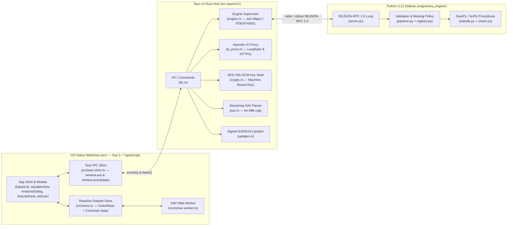

# ARAStat — System Architecture Reference (`architecture.md`)

**Stack**: **Tauri v2 (Rust Host) + Vue 3 / TypeScript (Flat `src/`) + Python 3.12 (`ara_engine` Sidecar)**  
**Core Tenets**: **100% Local-First · Privacy-First · Provider-Agnostic AI · Golden-Tested Statistical Rigor**

---

## 1. High-Level System Topology



---

## 2. Compact Repository Structure

ARAStat enforces a flat, four-folder root directory (`engine/`, `src/`, `src-tauri/`, `tests/`) with zero nested enterprise boilerplate:

```text
arastat/
├── engine/                          # Python 3.12 statistical engine & fixture tools
│   ├── ara_engine/
│   │   ├── __main__.py              # Entry point (`python -m ara_engine`)
│   │   ├── server.py                # Stdin/stdout NDJSON-RPC 2.0 dispatcher
│   │   ├── registry.py              # Canonical schema & title registry for all analyses
│   │   ├── pipeline.py              # Input validation, listwise/pairwise policy, element builder
│   │   ├── statslib.py              # Pure NumPy/SciPy statistical implementations
│   │   ├── charts.py                # Deterministic inline SVG chart generators
│   │   ├── errors.py                # Structured error codes (1001–1005)
│   │   └── fixtures.py              # Deterministic golden fixture generator (`ara_engine.fixtures`)
├── src/                             # Flat Vite + Vue 3 frontend root
│   ├── index.html                   # Strict CSP entry HTML
│   ├── main.ts                      # App bootstrap (installs tauri-shim before mounting Vue)
│   ├── tauri-shim.ts                # Maps `window.ara` & `window.araUpdate` to `@tauri-apps/api`
│   ├── store.ts                     # Columnar reactive dataset state + transactional undo/redo
│   ├── specs.ts                     # Frontend analysis schemas (mirrors registry.py)
│   ├── runAnalysis.ts               # RPC client wrapper & notification stream router
│   ├── results.ts                   # Reactive Run & ResultElement state tree
│   ├── exports.ts                   # APA 7th HTML & TSV clipboard/file exporters
│   ├── advisor.ts                   # Local statistical test & data readiness advisor
│   ├── quality.ts                   # 10-detector column quality & health scanner
│   ├── expr.ts                      # CSP-safe recursive-descent formula evaluator (no eval)
│   ├── missing.ts                   # Imputation & missingness utilities
│   ├── transforms.ts                # Log, Z-score, binning, and category merge transforms
│   ├── io/                          # File format codecs (.ara ZIP, CSV, XLSX, SAV)
│   └── shared/                      # TypeScript IPC contracts (ara-api.ts, update-api.ts)
├── src-tauri/                       # Rust host crate (`arastat`)
│   ├── tauri.conf.json              # Frameless window, strict CSP, sidecar & updater config
│   ├── capabilities/default.json    # Least-privilege Tauri v2 capability ACL
│   └── src/
│       ├── main.rs                  # Binary entry point
│       ├── lib.rs                   # Tauri builder, command registration, lifecycle hooks
│       ├── engine.rs                # Python sidecar process supervisor & orphan prevention
│       ├── ai_proxy.rs              # Provider-agnostic AI HTTP client (Gemini / OpenAI / Local)
│       ├── crypto.rs                # AES-256-GCM local API key encryption (`ai-config.bin`)
│       ├── sav.rs                   # Native Rust SPSS `.sav` reader (streaming + compression)
│       ├── recent.rs                # Recent files persistence (`recent.json`)
│       └── updater.rs               # Ed25519 signed update state machine & GitHub release notes
└── tests/                           # Automated verification suite
    ├── ref.test.js                  # Golden reference parity runner (`rel=1e-9`, `abs=1e-12`)
    ├── *.test.js                    # Unit tests for store, quality, advisor, io, exports
    └── fixtures/                    # Golden CSV inputs, specs, and expected JSON outputs
        ├── tier1/                   # Core parametric & nonparametric golden fixtures
        └── tier2/                   # Advanced & multivariable golden fixtures
```

---

## 3. Subsystem Contracts & Invariants

### 3.1 Frontend Dataset Store (`src/store.ts` & `src/io/types.ts`)
- **Columnar In-Memory Representation**:
  - `state.ds.columns`: `ColumnMeta[]` (`name`, `type: 'numeric' | 'string' | 'date'`, `decimals`, `label`, `valueLabels`, `missing: { values, ranges }`, `width`, `align`, `measure: 'nominal' | 'ordinal' | 'scale' | 'ratio'`).
  - `state.ds.data`: `Record<string, Array<number | string | null>>` where every column array has identical length `rowCount`.
- **Transactional Undo/Redo**:
  - Every mutation (`cell`, `batchCells`, `rowAdd`, `rowDel`, `colAdd`, `colDel`, `meta`, `replaceDataset`) commits a reversible delta onto `undoStack` (capped at `100` steps) so `Ctrl+Z` / `Ctrl+Y` is instantaneous and deterministic.
- **User-Missing Semantics (`isUserMissing`)**:
  - A cell is treated as missing if its value is `null`, `""`, or matches the column's `missing.values` (up to 3 discrete sentinel codes, e.g. `99`, `999`, `-1`) or `missing.ranges` (`[low, high]`).
  - Before sending data to `ara_engine`, `src/runAnalysis.ts` converts all user-missing cells to `null` so the Python engine receives clean `null`-normalized arrays.

### 3.2 Native-to-Engine JSON-RPC 2.0 Protocol (`src-tauri/src/engine.rs` ↔ `engine/ara_engine/server.py`)
- **Transport**: Newline-delimited UTF-8 JSON (`NDJSON-RPC 2.0`) over child `stdin` and `stdout`.
- **Process Supervision & Zero Orphan Guarantee**:
  - In development, `engine.rs` spawns `engine/.venv/Scripts/python.exe -m ara_engine` (or `bin/python`). In production bundles, it spawns the PyInstaller-compiled `ara_engine` binary from the Tauri resource directory.
  - **Windows**: Assigns the child process to a Win32 Job Object configured with `JOB_OBJECT_LIMIT_KILL_ON_JOB_CLOSE`.
  - **Linux**: Sets `prctl(PR_SET_PDEATHSIG, SIGKILL)` inside `pre_exec`.
  - **Graceful Exit**: Hooked to `tauri::RunEvent::Exit` to terminate the child cleanly.
- **Request (`run_analysis`)**:
  ```json
  {
    "jsonrpc": "2.0",
    "id": 1,
    "method": "run_analysis",
    "params": {
      "runId": "run-1",
      "analysisId": "ttest_independent",
      "spec": { "dep": "score", "group": "condition" },
      "data": { "score": [12.4, 15.1, null], "condition": ["A", "B", "A"] },
      "missingPolicy": "listwise"
    }
  }
  ```
- **Streaming Notifications (`analysis/update` & `analysis/done`)**:
  - `ara_engine` emits `analysis/update` notifications carrying `patches: [{ op: 'upsert', address, element }]` (`table`, `chart`, `note`, `error`), followed by a terminal `analysis/done` notification containing the raw numerical `stats` dictionary (used for golden fixture verification at `1e-9` relative tolerance).
- **Engine Error Taxonomy (`engine/ara_engine/errors.py`)**:
  - `1001`: Unknown analysis ID or invalid/unknown spec option key.
  - `1002`: Option value type mismatch.
  - `1003`: Referenced column missing from dataset.
  - `1004`: Numerical precondition failure (e.g., zero variance, $<2$ valid observations, $\ne 2$ groups for a 2-group test, singular matrix). Always carries an actionable `data.userMessage`.

### 3.3 Provider-Agnostic AI & Local Key Vault (`src-tauri/src/ai_proxy.rs` & `crypto.rs`)
- **Zero Plaintext API Keys**:
  - API keys are encrypted at rest in `<AppData>/ai-config.bin` using **AES-256-GCM** (`aes-gcm` crate) with a key derived via **SHA-256** from the OS machine hardware UUID (`HKLM\SOFTWARE\Microsoft\Cryptography\MachineGuid` on Windows, `/etc/machine-id` on Linux, `IOPlatformUUID` on macOS).
  - The frontend **never** receives the raw API key back from `ai_get_settings`—only a masked `keyHint` (e.g. `"AIza...7x9Q"`).
- **Rust-Side HTTP Proxy (`ai_complete` & `ai_list_models`)**:
  - All AI completions and `/v1/models` discovery calls execute in Rust via `reqwest` (`rustls-tls`), bypassing browser CORS restrictions.
  - **Endpoint Policy**: Remote endpoints must use `https://`. Plain `http://` is permitted **only** for loopback addresses (`localhost`, `127.0.0.1`, `[::1]`) to support local self-hosted inference engines (**Ollama**, **LM Studio**, **vLLM**, **llama.cpp**) without an API key.
- **Privacy & Anti-Hallucination Grounding (`src/ai.ts`)**:
  - Raw dataset rows are **never** transmitted to any AI provider. Only column metadata (names, labels, measurement scales, missing counts, and summary statistics) and completed APA table summaries are included in the system context.

### 3.4 `.ara` Project Archive Format (`src/io/araFormat.ts`)
- A `.ara` file is a standard **ZIP archive** (`fflate`) containing:
  - `manifest.json`: Format version, creation timestamp, app version.
  - `meta.json`: `ColumnMeta[]` variable definitions and `computedFormulas`.
  - `data.json`: Columnar dataset arrays.
  - `results.json`: Serialized `Run[]` history so reopening a `.ara` project restores all tables, charts, and interpretations intact.
